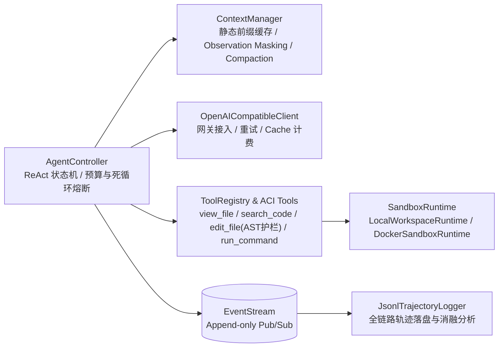

# coding-agent-harness

Repo-level Coding & CI Self-Healing Agent Harness — 面向真实代码仓库的自主 Issue 修复与 CI 自愈智能体系统（Docker 隔离沙箱、ACI 工具层、Tree-sitter Repo Map、长上下文工程与 SWE-bench 自动化评测闭环）。

## 核心架构



## 目录结构

```text
coding-agent-harness/
├── pyproject.toml                     # 项目配置与可选依赖（docker / repomap / eval / dev）
├── .env.example                       # LLM 网关、预算与沙箱环境变量模板
├── docs/
│   ├── coding-agent-study-guide.md    # 深度学习手册（论文 / 博客 / 架构 / 面试题）
│   ├── coding-agent-study-guide.docx  # 深度学习手册（Word 版）
│   ├── week1-plan.md                  # 第一阶段每日执行计划与验收清单
│   └── devlog-week1.md                # 第一阶段实测与轨迹复盘
├── data/                              # 固定的 Verified 30 题评测集与 5 题冒烟集
├── scripts/                           # 抽样、Docker 批量修复与 SWE-bench 评测
├── src/harness/
│   ├── config.py                      # LLM / Sandbox / Context / Harness 配置
│   ├── events/                        # Typed Action/Observation/Event + EventStream + JSONL Logger
│   ├── runtime/                       # SandboxRuntime 抽象 + Local / Docker 隔离沙箱
│   ├── tools/                         # ToolRegistry + 5 个正交 ACI 工具（含 3 级容错编辑与 AST 拦截）
│   ├── llm/                           # OpenAI 兼容网关客户端（零三方依赖）+ MockLLMClient
│   ├── context/                       # 静态前缀保缓存 + Observation Masking + Compaction
│   ├── repomap/                       # Python AST 代码骨架生成（后续升级 Tree-sitter + PageRank）
│   ├── agent/                         # AgentController（ReAct 循环 / 费用熔断 / 重复调用检测）
│   └── eval/                          # SWE-bench JSONL 导出器 + E1~E6 失败归因与消融统计
└── tests/                             # 离线单元测试与端到端 Mock Agent 修复测试
```

## 快速开始

核心框架零外部依赖（Python 3.11+ 标准库即可直接运行与测试）：

```bash
# 1. 运行全量单元测试（含端到端 Mock Agent 自动修 Bug 闭环测试）
PYTHONPATH=src python3 -m unittest discover -s tests -v

# 2. 生成当前仓库的 AST 代码地图
PYTHONPATH=src python3 -m harness repomap --repo .

# 3. 连接你的 LLM 网关运行本地任务
cp .env.example .env
# 编辑 .env，填写网关密钥。示例默认配置为 DeepSeek Flash。
set -a
source .env
set +a
PYTHONPATH=src python3 -m harness solve --repo /path/to/repo --task "Fix failing unit test ..." --with-repomap
```

安装扩展能力（Docker SDK / Tree-sitter / SWE-bench）：

```bash
uv venv && source .venv/bin/activate
uv pip install -e ".[all]"
```

## Week 1 SWE-bench 冒烟

固定数据来自 SWE-bench Verified 的指定修订。30 题按仓库和难度分层，5 题冒烟集跨 5 个仓库，且都属于 30 题集合。运行 `python scripts/sample_swebench.py` 可以校验固定文件。 [SWE-bench Verified](https://huggingface.co/datasets/SWE-bench/SWE-bench_Verified/tree/78f471bf655a3137b2e8a75af1501690ec009ec3)

安装 `.[dev,eval,docker]` 后，在仓库根目录运行。Docker 需要支持 `linux/amd64`。每次运行使用新输出目录。

```bash
python scripts/run_swebench_eval.py --mode empty --output-dir runs/smoke/empty
python scripts/run_swebench_eval.py --mode gold --output-dir runs/smoke/gold

set -a
source .env
set +a
python scripts/run_agent_batch.py --output-dir runs/smoke/agent
python scripts/run_swebench_eval.py --mode predictions \
  --predictions runs/smoke/agent/predictions.jsonl --output-dir runs/smoke/scored
```

批跑以 20 步和每题 $0.15 的估算费用为上限，收到每步用量后检查预算。批跑目录包含 `predictions.jsonl`、`results.jsonl` 和逐题 JSONL 轨迹。评测目录的 `summary.json` 包含 Pass@1、F2P/P2P 列表和耗时。完整 30 题可通过 `--dataset data/swebench_verified_30.jsonl` 指定。

Week 1 实测通过 Empty Patch **0/5** 和 Gold Patch **5/5** 校验，DeepSeek Flash 冒烟为 **2/5（40%）**。 [实测与轨迹复盘](docs/devlog-week1.md)

## 演进路线（8 周计划）

- [x] **V0.0 基础框架**：EventStream + Local/Docker SandboxRuntime + 正交 ACI 工具 + ContextManager + AgentController + Eval 脚手架与全套单测
- [ ] **V0.1 Baseline**：接入 SWE-bench Verified 30 题子集与 Docker 评测闭环，产出 Baseline 分数
- [ ] **V0.2 精准定位**：V0.1 Bad Case 归因（E1~E6）+ Tree-sitter & Personalized PageRank Repo Map 升级
- [ ] **V0.3 长上下文与容错**：阈值自动 Compaction + Git Checkpoint/Rollback + 网关 Prompt Caching 降本验证
- [ ] **V0.4 验证闭环与解耦**：Reproduce → Fix → Verify 门禁 + 只读 Explorer Subagent + 50 题完整消融表
- [ ] **工程化**：异步并发沙箱队列 + GitHub Webhook / CI 自愈提 Draft PR + 轨迹回放看板
