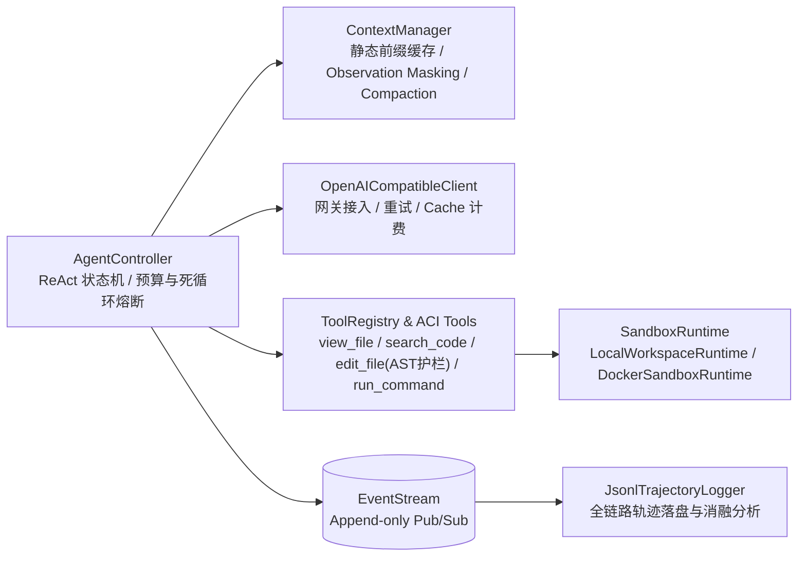

# coding-agent-harness

Repo-level Coding & CI Self-Healing Agent Harness — 面向真实代码仓库的自主 Issue 修复与 CI 自愈智能体系统（Docker 隔离沙箱、ACI 工具层、Tree-sitter Repo Map、长上下文工程与 SWE-bench 自动化评测闭环）。

## 核心架构



## 目录结构

```text
coding-agent-harness/
├── pyproject.toml                     # 项目配置与可选依赖（docker / repomap / eval / dev）
├── .env.example                       # LLM 网关、预算与沙箱环境变量模板
├── docs/
│   ├── coding-agent-study-guide.md    # 深度学习手册（论文 / 博客 / 架构 / 面试题）
│   ├── coding-agent-study-guide.docx  # 深度学习手册（Word 版）
│   ├── week1-plan.md                  # 第一阶段每日执行计划与验收清单
│   ├── devlog-week1.md                # 第一阶段实测与轨迹复盘
│   └── progress.md                    # 阶段进展、异构远端执行架构与并发基准
├── learn.md                           # Week 1 技术笔记与设计取舍
├── result.md                          # Week 1 验证结果、命令与踩坑记录
├── data/                              # 固定的 Verified 30 题评测集与 5 题冒烟集
├── scripts/                           # 抽样、Docker 批量修复与 SWE-bench 评测
├── src/harness/
│   ├── config.py                      # LLM / Sandbox / Context / Harness 配置
│   ├── events/                        # Typed Action/Observation/Event + EventStream + JSONL Logger
│   ├── runtime/                       # SandboxRuntime 抽象 + Local / Docker 隔离沙箱
│   ├── tools/                         # ToolRegistry + 5 个正交 ACI 工具（含 3 级容错编辑与 AST 拦截）
│   ├── llm/                           # OpenAI 兼容网关客户端（零三方依赖）+ MockLLMClient
│   ├── context/                       # 静态前缀保缓存 + Observation Masking + Compaction
│   ├── repomap/                       # Python AST 代码骨架生成（后续升级 Tree-sitter + PageRank）
│   ├── agent/                         # AgentController（ReAct 循环 / 费用熔断 / 重复调用检测）
│   └── eval/                          # SWE-bench JSONL 导出器 + E1~E6 失败归因与消融统计
└── tests/                             # 离线单元测试与端到端 Mock Agent 修复测试
```

## 快速开始

核心框架零外部依赖（Python 3.11+ 标准库即可直接运行与测试）：

```bash
# 1. 运行全量单元测试（含端到端 Mock Agent 自动修 Bug 闭环测试）
PYTHONPATH=src python3 -m unittest discover -s tests -v

# 2. 生成当前仓库的 AST 代码地图
PYTHONPATH=src python3 -m harness repomap --repo .

# 3. 连接你的 LLM 网关运行本地任务
cp .env.example .env
# 编辑 .env，填写网关密钥。示例默认配置为 DeepSeek Flash。
set -a
source .env
set +a
PYTHONPATH=src python3 -m harness solve --repo /path/to/repo --task "Fix failing unit test ..." --with-repomap
```

安装扩展能力（Docker SDK / Tree-sitter / SWE-bench）：

```bash
uv venv && source .venv/bin/activate
uv pip install -e ".[all]"
```

## Week 1 SWE-bench 冒烟

固定数据来自 SWE-bench Verified 的指定修订。30 题按仓库和难度分层，5 题冒烟集跨 5 个仓库，且都属于 30 题集合。运行 `python scripts/sample_swebench.py` 可以校验固定文件。 [SWE-bench Verified](https://huggingface.co/datasets/SWE-bench/SWE-bench_Verified/tree/78f471bf655a3137b2e8a75af1501690ec009ec3)

安装 `.[dev,eval,docker]` 后，在仓库根目录运行。Docker 需要支持 `linux/amd64`。每次运行使用新输出目录。

```bash
python scripts/run_swebench_eval.py --mode empty --output-dir runs/smoke/empty
python scripts/run_swebench_eval.py --mode gold --output-dir runs/smoke/gold

set -a
source .env
set +a
python scripts/run_agent_batch.py --output-dir runs/smoke/agent
python scripts/run_swebench_eval.py --mode predictions \
  --predictions runs/smoke/agent/predictions.jsonl --output-dir runs/smoke/scored
```

批跑预算默认读取环境配置，可用 `--max-steps` 和 `--max-cost` 覆盖。示例 `.env.example` 为 20 步和每题 $0.15，收到每步用量后检查预算。批跑目录包含 `predictions.jsonl`、`results.jsonl` 和逐题 JSONL 轨迹。评测目录的 `summary.json` 包含 Pass@1、F2P/P2P 列表和耗时。完整 30 题可通过 `--dataset data/swebench_verified_30.jsonl` 指定。

Week 1 实测通过 Empty Patch **0/5** 和 Gold Patch **5/5** 校验，DeepSeek Flash 冒烟为 **2/5（40%）**。 [实测与轨迹复盘](docs/devlog-week1.md)

## 批跑重试与消融

批跑与官方评测都在输出目录逐题保存结果。首次运行使用新目录，恢复时复用相同输入并追加 `--resume`。批跑重新运行缺失或 `error` 的实例，评测重新运行缺失、超时或 `evaluation_error` 的实例。两者默认单并发，可用 `--workers` 控制。评测连接错误默认重试两次，`--retries` 和 `--docker-timeout` 可配置。

```bash
python scripts/run_agent_batch.py --dataset data/swebench_verified_30.jsonl \
  --max-steps 20 --max-cost 0.15 --workers 2 --output-dir runs/baseline
python scripts/run_swebench_eval.py --dataset data/swebench_verified_30.jsonl \
  --mode predictions --predictions runs/baseline/predictions.jsonl \
  --workers 2 --output-dir runs/baseline-score
```

默认批跑保留 V0.1 行为。分别加入以下选项，使用同一题集、模型和预算进行消融。

| 批跑选项 | 作用 |
| --- | --- |
| `--pipefail` | 管道中的测试进程失败时，将失败退出码传回 Agent。独立本地和 Docker Runtime 默认启用。 |
| `--with-loop-recovery` | 跳过第一次触发循环保护的调用，建议调整操作，提供 checkpoint 和 rollback。 |
| `--with-verification` | 用仓库工作树验证业务补丁。`run_test` 和 `run_command` 均可记录测试结果，证据绑定到业务源码差异。提交前清理既有测试修改和新增临时文件。该选项同时启用 pipefail。 |
| `--with-repomap` | 使用 Tree-sitter Python 解析和 Personalized PageRank 生成仓库图，需安装 `.[repomap]`。 |
| `--with-compaction` | 保留原任务前缀，在 `--compaction-tokens` 阈值（默认 18,000 个估算 Token）触发时，用结构化摘要压缩历史。轨迹记录压缩前后的估算量。 |

`scripts/compare_harness_runs.py` 读取基线和消融组的批跑与评测产物，报告 Pass@1、首次用 `view_file` 或 `edit_file` 命中金标准文件的步数、空补丁数、缓存命中率、Token 和成本。可重复传入 `--variant RUN SCORE` 生成成组对比报告。

评测提供 `--network none`，可用相同 Gold/Empty 对照核查隔离时的行为。先对完整 30 题做默认网络对照，再用其中 5 道 Requests 题做隔离对照。`scripts/audit_swebench_controls.py` 生成逐题记录，`--noise-audit` 可在评分中并列报告原始全量指标和排除有外网故障证据的子集指标。

Windows Docker 隧道端点通过本地 `.env` 或环境变量配置，模板见 [.env.example](.env.example)。

Week 2 冻结 30 题的 Gold 对照为 **26/30（86.7%）**，首轮 20 步 V0.1 基线为 **10/30（33.3%）**，原外网噪声审计口径下为 **10/27（37.0%）**。36 步基线官方 Pass@1 为 **17/30（56.7%）**，按原外网噪声审计为 **17/27（63.0%）**。四组评测已完成。 [消融对比](runs/week2/ablation-36steps.md) [项目进展](docs/progress.md)

Week 3 保留冻结 30 题的主指标，并使用新版网络噪声审计统一计算 26 题去噪子集。完成零泄露工作树门禁与根因级 Harness 优化（消除上下文失忆 + 300 行阅读窗 + 系统提示词升级 + `--thinking enabled` 安全回放与截断恢复）后，同模型（`deepseek-flash`）30 题官方 Pass@1 达到 **21/30（70.0%）**，26 题去噪子集达 **20/26（76.9%）**，空补丁与循环熔断均降至 0，Prompt Cache 命中率升至 **84.0%**。 [项目进展](docs/progress.md#week-3-通过率突破--根因级-harness-优化boost-30) · [执行计划](plan.md) · [问题台账](fix.md)

## 演进路线（8 周计划）

- [x] **V0.0 基础框架**：EventStream + Local/Docker SandboxRuntime + 正交 ACI 工具 + ContextManager + AgentController + Eval 脚手架与全套单测
- [x] **V0.1 Baseline**：接入 SWE-bench Verified 30 题子集与 Docker 评测闭环，产出 Baseline 分数
- [ ] **V0.2 精准定位**：V0.1 Bad Case 归因（E1~E6）+ Tree-sitter & Personalized PageRank Repo Map 升级
- [ ] **V0.3 长上下文与容错**：阈值自动 Compaction + Git Checkpoint/Rollback + 网关 Prompt Caching 降本验证
- [ ] **V0.4 验证闭环与解耦**：Reproduce → Fix → Verify 门禁 + 只读 Explorer Subagent + 50 题完整消融表
- [ ] **工程化**：异步并发沙箱队列 + GitHub Webhook / CI 自愈提 Draft PR + 轨迹回放看板
