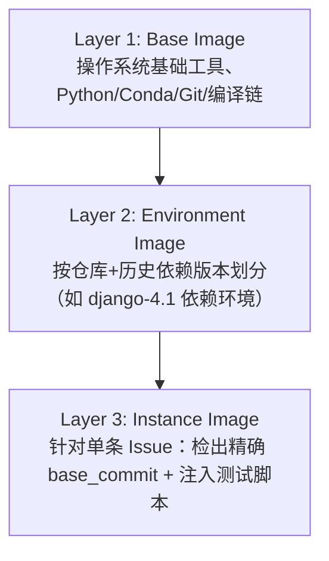
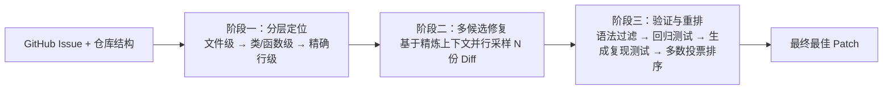
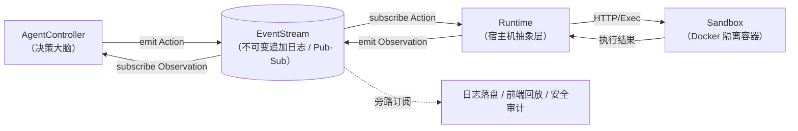
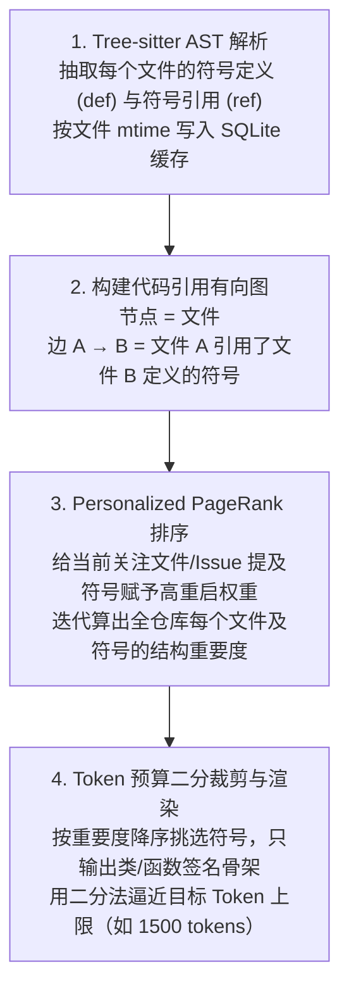

# 仓库级 Coding / CI 自愈 Agent 工程化深度学习手册

> 本手册专为“仓库级 Coding / DevOps 自愈 Agent”项目打造，直接提炼并整合了该领域最具影响力的 **4 篇核心论文、3 篇工业级工程博客、2 个标杆开源项目架构**，以及落地所需的 **沙箱隔离、ACI 工具协议、上下文工程与评测体系** 的全部核心干货。

---

## 第 1 章：评测体系基石 —— SWE-bench 原理与 Harness 架构

做 Coding Agent 最大的忌讳是“只靠肉眼看一两个 Demo 觉得行了”。业界衡量仓库级代码修复能力的黄金标准是 **SWE-bench**（Princeton NLP 提出）。理解它的底层机制，既是搭建本地评测脚手架的前提，也是面试中展示工程严谨度的核心加分项。

### 1.1 数据集三大版本与选型

SWE-bench 的每条样本都来自真实开源 Python 仓库（如 `django`、`sympy`、`scikit-learn`、`pytest`、`requests` 等）的历史 GitHub Issue 及其对应的真实修复 PR：

| 版本 | 样本量 | 特点与适用场景 |
| :--- | :---: | :--- |
| **SWE-bench Full** | 2,294 | 原始完整集，包含部分描述不清、测试依赖复杂或过于冷门的样本，全量跑一次成本极高 |
| **SWE-bench Lite** | 300 | 筛选出描述更清晰、单文件修改为主的子集，适合低成本快速迭代（但仍含少量歧义样本） |
| **SWE-bench Verified** | 500 | 由人类软件工程师逐条人工审计清洗，剔除了描述模糊、测试过严或环境损坏的样本，是当前最权威的基准 |

**个人项目推荐策略**：从 **SWE-bench Verified** 中按不同仓库和难度分层抽取 **20~30 条**作为本地快速迭代集（V0.1 → V0.3），最终冲刺阶段扩展到 **50 条**出完整消融实验报告。

### 1.2 三层 Docker 镜像架构

为了在数百个不同历史版本的仓库间实现**完全隔离、可复现、且复用缓存构建**，SWE-bench 的评测脚手架采用了严格的三层 Docker 镜像分层设计：



1. **Base Image（基础镜像）**：包含通用 OS 工具、包管理器（pip/conda）、编译器。
2. **Environment Image（环境镜像）**：按仓库与历史依赖快照构建（例如 `django` 在某个年份的依赖组合），预装耗时极长的 C 扩展和第三方库，多条同年代 Issue 共享同一个环境镜像。
3. **Instance Image（实例镜像）**：最细粒度的一层，针对单条任务（如 `sympy__sympy-11618`）将代码仓库精确 `git checkout` 到修复前的 `base_commit`。

### 1.3 评测执行流水线与判定矩阵

每条样本在元数据中包含两份关键 Patch：
- `patch`（Gold Patch）：原 PR 真正修改业务代码的补丁（Agent 不可见，仅作参考）。
- `test_patch`：原 PR 新增或修改的单元测试补丁（**评测时由 Harness 强制注入，防止 Agent 偷改测试作弊**）。

评测流程严格分为四步：
1. 启动该任务的 Instance Docker 容器（处于 `base_commit` 状态）。
2. 将你的 Agent 输出的 `model_patch`（标准 Git Diff）通过 `git apply` 打入工作区；若 `git apply` 失败直接判负。
3. 将基准自带的 `test_patch` 覆盖写入测试文件，执行该仓库对应的测试命令（如 `pytest ...`）。
4. 解析测试输出日志，核对两类测试用例集合：

| 测试集合 | 含义 | 修复前（`base_commit`） | 修复后（打入 `model_patch`） |
| :--- | :--- | :---: | :---: |
| **`FAIL_TO_PASS` (F2P)** | 复现当前 Bug 的核心测试 | FAIL | **必须全部 PASS** |
| **`PASS_TO_PASS` (P2P)** | 仓库原有的正常单元测试（防回归） | PASS | **必须全部 PASS** |

**二值判定规则（Resolved / Pass@1）**：只有当 **所有 F2P 由失败转为通过，且所有 P2P 均保持通过（零回归）** 时，该任务才记为 `Resolved = True`。

### 1.4 搭建评测脚手架必须注意的工程坑
- **严禁数据泄露**：绝对不能让 Agent 在沙箱里通过 `git log` 看到未来提交（Instance 镜像在构建时已截断历史，但如果你自建 CI 评测集，务必删掉未来 commit 或 `shallow clone`）。
- **禁止模型改测试交卷**：Agent 在修复过程中可以自己写临时复现脚本，但最终导出 `model_patch` 前要清理临时文件，且评测时以官方 `test_patch` 为准。
- **解析超时与卡死**：坏补丁极易导致死循环测试，单条测试运行必须设置硬超时（如 180~300 秒）。

---

## 第 2 章：论文精读 —— Coding Agent 的三大范式演进

理解 Coding Agent 的设计，必须吃透三条截然不同却彼此互补的技术路线：**定制接口派（SWE-agent）**、**极简无状态派（mini-swe-agent）**、**确定性流水线派（Agentless）**。

---

### 2.1 SWE-agent（Princeton NLP）：ACI（Agent-Computer Interface）设计哲学

#### 核心命题
人类程序员使用 Linux 终端（HCI，Human-Computer Interface）效率很高，但大语言模型直接面对原始终端极易迷失：
- 用 `cat` 打开一个 2000 行的文件会直接撑爆注意力；
- 用 `sed`、`awk` 或 `echo >` 修改多行带缩进的代码极易写出语法错误；
- 用 `grep` 搜常见关键词会吐出几千行噪音。

论文提出：**正如人机交互需要 HCI，大模型与环境交互需要专门设计的 ACI（Agent-Computer Interface）**——通过受限、高信噪比、带防错护栏的专用指令，大幅提升模型操作代码库的能力。

#### ACI 的四大核心设计
1. **分窗式文件浏览器（File Viewer）**：
   - 每次只展示固定 **100 行**窗口，强制附带精确行号、文件总行数、当前窗口位置，配合 `open <file> <line>`、`scroll_up`、`scroll_down` 导航。
2. **高密度搜索指令（Search Commands）**：
   - `search_dir` / `search_file` / `find_file` 不返回冗长的原始 grep 文本，而是按文件聚合统计匹配次数（如 `file.py (5 matches)`），匹配超过阈值（如 50 个文件）直接提示缩小范围。
3. **带实时语法校验的编辑器（Edit + Linter Guardrail）**：
   - 封装 `edit <start_line>:<end_line>` 命令替换指定行区间。
   - **防呆护栏（Poka-Yoke）**：每次编辑写入前自动运行语法/静态检查（Linter）。一旦发现缩进错误、括号未闭合或语法错误，**拒绝写入并立刻把报错行号和修改前后预览返回给模型**，阻止错误滚雪球。
4. **历史观测折叠（History Processor）**：
   - 仅保留最近 **5 轮**完整的工具返回输出（Observations），更早的冗长输出折叠为一行简短占位符，同时保留模型所有的思考与动作记录。

#### 关键消融实验数据（SWE-bench Lite，GPT-4 Turbo）

| 实验配置 | Pass@1 (Resolved) | 相对基线变化 | 核心结论 |
| :--- | :---: | :---: | :--- |
| **完整 SWE-agent ACI** | **18.0%** | Baseline | 定制 ACI 相比纯 Shell 相对提升 **+64%** |
| 去掉 Linter 语法拦截 (`w/o linting`) | 15.0% | -3.0% | 缺少即时语法防呆，模型常陷入修语法死循环 |
| 去掉历史折叠 (`Full history`) | 15.0% | -3.0% | 无节制堆积历史输出显著劣化长链路推理 |
| 去掉 Few-shot 示范 (`w/o demo`) | 16.3% | -1.7% | 少量完整轨迹示例能降低工具格式出错率 |
| 改为全文件输出 (`Full file`) | 12.7% | -5.3% | 一次倾倒整文件会严重破坏模型定位与注意力 |
| 去掉专用编辑指令 (`No edit`) | 10.3% | -7.7% | 退化回用 shell 脚本拼字符串改代码，成功率腰斩 |
| 纯原生 Linux Shell (`Shell-only`) | ~10.9% | -7.1% | 原始人类终端界面对早期模型极不友好 |

---

### 2.2 mini-swe-agent（原班人马的范式反转）：极简主义与无状态执行

随着新一代强推理/强代码模型（如 Claude 3.5/3.7/4 系列、o3/GPT-5 等）的成熟，SWE-agent 的原班人马反手推出了 **`mini-swe-agent`**，用极简设计打破了“重型脚手架才有效”的迷思：核心逻辑仅约 **100 行 Python**，却在 SWE-bench Verified 上追平甚至反超了复杂的重型框架（配合顶级模型达到 74%+）。

#### 原版 SWE-agent vs mini-swe-agent 核心差异对比

| 维度 | 原版 SWE-agent | mini-swe-agent |
| :--- | :--- | :--- |
| **设计哲学** | 重型 ACI 脚手架，弥补模型操作终端的短板 | 极简主义，相信现代强模型原生精通 Bash |
| **核心代码量** | 数千行模块、YAML 工具清单、专用运行时（SWE-ReX） | ~100 行核心 Python 循环 |
| **工具范式** | 定制文件浏览器/编辑器 + 原生 Tool-calling API | **纯 Bash（Bash-only）**，不用原生 Tool-call API，直接从回复提取 bash 代码块执行 |
| **执行状态** | **有状态（Stateful）**：维护持久化交互式 Shell 会话（保留 `cd`、环境变量、虚拟环境） | **无状态（Stateless）**：每条命令独立执行（`subprocess.run` / `docker exec`），互不残留会话脏状态 |
| **上下文历史** | 复杂中间格式解析、自定义窗口状态拼装 | **纯线性消息列表（`messages`）**：轨迹即 Prompt，调试和微调数据零转换 |
| **环境与模型兼容** | 需向目标容器注入定制脚本；强依赖模型的 Tool-calling 遵守度 | 只要目标环境有 shell 即可零侵入运行；任意开源/闭源模型一行切换 |

#### 给你的核心架构启示（面试极易加分）
- **不要盲目崇拜“极简”或“重脚手架”，要看模型能力与生产约束**：
  - 如果你用**中小参数开源模型或高性价比模型**，**专用 `edit_file`（Search/Replace）+ Linter 防呆 + 窗口化阅读** 依然能显著拉高成功率。
  - 在**运行时状态管理**上，借鉴 `mini-swe-agent` 的思想：**尽量避免脆弱的长连交互式 TTY 会话**（极易因为进程挂起、转义字符乱码、提示符识别失败而卡死），改用**无状态命令执行（每次显式指定 `workdir` 与超时）+ 显式持久化少量环境状态**，能极大提升高并发沙箱的稳定性。

---

### 2.3 Agentless（UIUC）：非 Agent 化的三阶段确定性流水线

#### 核心质疑
UIUC 团队提出一个尖锐的问题：**解决真实软件 Bug，真的需要让大模型在一个自由循环里自己摸索几十步吗？**
自由自主 Agent 存在三大痛点：
1. **成本高**：探索过程充满无效试错，单题常消耗数美元。
2. **错误滚雪球**：早期定位偏了，后面 30 步全在错误方向上打转。
3. **不可控**：难以复现、难以定位到底是哪一环出了问题。

#### 三阶段确定性架构



1. **阶段一：分层故障定位（Hierarchical Fault Localization）**
   - **Step 1（文件级）**：把仓库目录树 + Issue 描述喂给 LLM，选出 Top-K（如 3~5 个）最可能相关的文件（也可结合嵌入检索互补）。
   - **Step 2（类/函数级）**：将这几个文件压缩为**骨架代码（仅保留类名、函数名、签名、关键注释，隐藏函数体）**，让 LLM 锁定具体可疑的类和函数。
   - **Step 3（编辑位置级）**：只展开可疑函数的完整代码及上下文行，让 LLM 圈定精确需要修改的行区间。
   - *价值*：把百万行代码仓库逐层漏斗压缩到几百行高纯度上下文，完全没有探索死循环。

2. **阶段二：多候选并行修复（Repair）**
   - 将精准定位后的代码片段交给 LLM，用较高温度并行采样生成 **多份候选 Patch**（例如 10~40 份，采用 `SEARCH/REPLACE` 格式）。
   - 规避了单次生成撞运气的问题，把“串行多轮试错”转化为“并行多采样探索”。

3. **阶段三：严格验证与重排（Patch Validation）**
   - **语法与规范化过滤**：剔除无法应用或语法报错的补丁，并对功能等价的补丁（忽略空行/注释差异）做归一化去重。
   - **现有回归测试过滤**：先跑仓库原有测试集，淘汰破坏旧功能的补丁。
   - **自动生成复现测试（Reproduction Tests）**：让 LLM 根据 Issue 描述单独生成多份能复现 Bug 的测试脚本，筛选出在原始代码上确实 **FAIL** 的有效复现测试，再用它们去测所有候选补丁。
   - **加权排序选优**：综合“通过复现测试数 + 归一化后出现频次（多数投票 Majority Voting）”选出最终提交的 Patch。

#### 关键结论与对我们项目的启发
- **性价比惊人**：发布时仅用约 **$0.34~$0.70 / 题** 就击败了当时绝大多数复杂开源 Agent；配合 Claude 3.5 Sonnet 在 SWE-bench Verified 上突破 50%。
- **混合架构（Hybrid）才是工程最优解**：
  - 在你的项目中，可以吸收 Agentless 的**“强制生成复现测试”**和**“分层先看骨架再读源码”**思想，同时保留 Agent 的**“看到测试报错后动态反思迭代”**能力。面试被问到 *“Agentless 和自主 Agent 怎么选”* 时，你可以直接从 **任务确定性、环境交互需求（如动态调试/查日志）、成本与延迟预算** 三个维度给出深度回答。

---

## 第 3 章：工业级工程博客精读 —— 编排、上下文工程与多 Agent 边界

---

### 3.1 Anthropic：《Building Effective Agents》全解

#### 核心界定：Workflow vs Agent
Anthropic 首先划清了一条关键边界：
- **Workflow（工作流）**：由**预先写好的确定性代码路径**编排 LLM 与工具调用。优点是稳定、可预测、低延迟、易调试。
- **Agent（智能体）**：由 **LLM 自身在循环中动态决定**下一步流程、调用什么工具、何时结束，并持续接收环境反馈。优点是能处理步骤数无法预知的开放式复杂任务（如修未知仓库 Bug），代价是成本更高、误差可能累积。

#### 五大基础工作流模式

| 模式 | 核心机制 | 适用场景 | 在 Coding Agent 中的落地方式 |
| :--- | :--- | :--- | :--- |
| **1. Prompt Chaining（提示词链）** | 拆成固定串行步骤，前一步输出喂给后一步，中间可插代码门禁（Gate） | 流程固定且各阶段目标单一 | Issue 摘要提取 → 生成复现脚本 → 校验脚本确实报错 |
| **2. Routing（路由）** | 分类器先判别输入类型，路由到不同专用提示词/模型/分支 | 简单与复杂任务差异大 | 简单 Lint/格式报错走便宜快模型；复杂逻辑 Bug 走强推理模型 |
| **3. Parallelization（并行化）** | 分两种：**Sectioning**（任务分片并行处理后聚合）与 **Voting**（同一任务多跑几次投票） | 降延迟或提准确率 | 同时在多个模块搜线索；或对高风险 Patch 跑多视角代码审查投票 |
| **4. Orchestrator-Workers（编排者-执行者）** | 中心 LLM 动态拆解未知数量的子任务，派给 Worker 并汇总 | 子任务数量和范围运行前未知 | 跨多文件大型重构，主 Agent 拆解阅读/调研子任务给只读子 Agent |
| **5. Evaluator-Optimizer（评估者-优化者）** | 生成者产出初稿，评估者按标准给反馈，迭代修改直到达标 | 有清晰评估标准且迭代收益明显 | Patch 生成 + 单测/Linter/自检 Rubric 反馈闭环 |

#### 三条工程铁律
1. **保持简单（Start Simple）**：能用单次调用 + 检索解决的别上工作流，能用工作流解决的别上完全自主 Agent。
2. **优先透明，警惕黑盒框架**：框架隐藏了底层 Prompt 和消息流，出了 Bad Case 极难排查；核心循环强烈建议自己直接基于基础 SDK 手写（几十到几百行）。
3. **像设计人类 UI 一样打磨工具（ACI）**：投入到工具描述、参数命名、防错提示（例如强制使用绝对路径防止相对路径错乱）的精力，应该不亚于写 System Prompt。

---

### 3.2 Anthropic：《Effective Context Engineering for AI Agents》全解

#### 从 Prompt Engineering 到 Context Engineering
在单轮问答时代，重点是如何雕琢一段提示词；在长链路 Agent 时代（动辄 30~100 步），真正决定成败的是 **Context Engineering（上下文工程）**——即**在每一步推理时，系统性地管理进入 LLM 上下文窗口的全部信息集合**（System Prompt、工具定义、外部检索、历史对话、工具返回值）。

#### 核心敌人：Context Rot（上下文腐败）
即使模型号称支持 200K / 1M 上下文，上下文也绝不是“免费无限内存”，而是稀缺的 **注意力预算（Attention Budget）**：
- 随着 Token 堆积，模型对关键信息的召回精度持续下滑（Context Rot）；
- 过期的报错信息、走偏的假设、上千行测试日志会造成 **上下文污染（Context Poisoning）**；
- 塞入几十个功能重叠的工具定义会引发 **上下文混淆（Context Confusion）**。

**第一原则**：始终维持 **“能完成当前任务所需的最小高信噪比 Token 集合”**。

#### 长周期任务的四大核心上下文策略

1. **JIT 检索（Just-in-Time Retrieval）**
   - 不要在启动时把整个仓库或大段无关文档预加载进上下文。
   - 只给轻量级指针/索引（如目录树、Repo Map、文件路径），让 Agent 用 `search_code`、`view_file` 按需现查现看，就像人类开发者不会背诵整座代码库，而是靠文件系统和搜索按需打开。

2. **工具返回裁剪（Tool-Result Clearing / Observation Masking）**
   - Coding Agent 80% 以上的 Token 消耗来自历史工具输出（大段源码、`pytest` 堆栈、`git log`）。
   - **最轻量且高效的压缩**：保留完整对话流结构，但将 **N 轮之前（例如超过最近 5 轮）** 的大体积 Tool Result 替换为极简占位摘要（如 `[Output omitted: viewed auth.py L1-100, 3200 chars]`）。模型若忘记细节随时可以重新读取，但注意力立刻被解放出来。

3. **结构化压缩（Compaction）**
   - 当上下文占用接近阈值（如窗口的 60%~70%）时，触发一次专门的压缩调用，将此前全部探索历史提炼为一份**高密度结构化工作快照**，然后开启一段干净的新对话前缀续跑。
   - **Coding Agent 压缩模板必须保留的四要素**：
     1. 原始任务目标与验收标准；
     2. 已确认的根因与关键文件/行号锚点；
     3. 已做出的代码改动与当前测试状态；
     4. **已经试过且失败的死胡同（极其重要，防止压缩后模型失忆重蹈覆辙）**。

4. **外部结构化记忆（Scratchpad / Notes）与子 Agent 隔离**
   - **外置工作笔记**：允许 Agent 把调查清单、进度计划写入沙箱内独立文件（或专门的 `notes` 字段），跨压缩周期持久存活。
   - **子 Agent 吸收脏上下文**：把“在陌生代码库里盲搜 20 个文件找调用链”这种高噪声任务交给只读 **Explorer Subagent**；子 Agent 内部消耗 30K Token，最终只返回一份 500 Token 的《精准文件路径+符号调用链结论》给主 Agent，保护主上下文干净。

#### 工具设计三大黄金准则
- **Token 高效**：工具内部做好分页、截断和格式精简，宁可返回“共找到 120 处，仅展示前 20 处，请细化正则”，也不要一炮轰出 5 万字符。
- **正交与最小化**：每个工具职责单一且互不重叠。如果连你自己都说不清 `search_text` 和 `find_pattern` 什么时候该用哪个，模型一定会选错。
- **可行动的报错信息**：工具执行出错时，返回给模型的错误信息必须告诉它**怎么修**（例如 `Edit failed: target snippet matched 3 locations (L14, L88, L120). Provide more surrounding lines to make it unique.`）。

#### Prompt Caching（前缀缓存）的架构约束
长链路 Coding Agent 每走 1 步都要把前面所有历史重新发给 LLM，输入 Token 呈 $O(N^2)$ 增长。开启 Prompt Caching 是将成本砍掉 **50%~80%** 的必杀技，但前提是你的代码必须保证 **严格前缀稳定（Prefix Stability）**：
- **缓存命中机制**：服务端按从头到尾的精确字节/Token 前缀匹配缓存，**哪怕第 100 个 Token 改了一个字符（比如放了实时时间戳），后面几万个 Token 的缓存全部失效！**
- **正确排布顺序（从静态到动态）**：
  1. `System Prompt`（完全静态，严禁插当前时间或动态步数）
  2. `Tools Schema`（工具列表顺序与定义固定不变，不要中途动态增删工具）
  3. 静态项目背景 / Repo Map（任务启动时确定，过程不轻易改动）
  4. 历史对话轨迹（只做 Append 追加；如果做 Observation Masking，注意不要频繁改写很靠前的位置，而是按周期批量做或配合 Compaction 重建缓存点）
  5. 当前轮最新的动态提示（如剩余步数提醒，放在最后一条 User/Tool 消息末尾）。

---

### 3.3 Cognition（Devin 团队）：《Don't Build Multi-Agents》全解

很多初学者一想到“大项目”，就下意识堆 5 个角色 Agent（产品经理、架构师、开发 A、开发 B、测试）互相聊天。Devin 团队结合大规模生产踩坑经验，泼了一盆非常清醒的冷水，提出构建可靠长链路 Agent 的两条第一性原理：

#### 原理一：Share Context（共享完整上下文）
- 多 Agent 框架最大的通病是 **上下文碎片化**——上游 Agent 把任务总结成一段简短指令丢给下游 Agent，就像玩 **“传话游戏（Game of Telephone）”**。
- 摘要必然丢失大量微妙的隐性细节（为什么排除了方案 A、某个函数的边界行为、用户暗含的约束），下游 Agent 在信息残缺下做出的决策必然走偏。

#### 原理二：Actions Carry Implicit Decisions（行动蕴含隐性决策）
- 每一次写代码动作（定义一个函数签名、选定异常处理方式、命名一个字段、处理空值逻辑）都包含了大量**未写进文档的隐性架构决策**。
- 如果你让两个并行编码的 Subagent 同时改不同模块，它们彼此看不到对方的实时决策，等最后把代码拼在一起时，接口假设、数据结构、错误语义全面打架，变成一团无法维护的 **“缝合怪（Frankenstein）”**，修复冲突的成本远高于单线程顺序写完。

#### 行业最终达成的架构共识
- **写操作（Code Editing / Architecture Decisions）保持单线程主上下文线性推进**，确保所有修改共享完整决策链。
- **并行多 Agent 严格限定在“无状态只读任务”**：如并行调研多个模块代码（Explorer）、并行执行多维度 Code Review、并行生成多个独立候选修复后做验证择优（类似 Agentless 阶段二）。

---

## 第 4 章：标杆开源项目架构拆解

---

### 4.1 OpenHands（原 OpenDevin）：事件驱动架构深度剖析

很多人的 MiniAgent 把 `while True`、LLM 调用、工具执行、日志打印全揉在一个大函数里，一旦要加前端可视化、断点续跑、安全审计或换沙箱就会彻底崩盘。**OpenHands** 给出了一套教科书级的解耦方案。

#### 核心事件流闭环



#### 五大核心组件职责
1. **EventStream（中心事件总线）**：
   - 本质是一个 **Append-only（只追加、不可变）的强类型事件日志 + 发布订阅中心**。
   - 它是整个系统的 **单一事实源（Single Source of Truth）**。前端界面、JSONL 轨迹记录器、Token 计费器、危险命令拦截器都只需作为旁路订阅者挂在 EventStream 上，完全零侵入核心循环。
2. **Action（强类型意图对象）**：
   - 用 Pydantic 定义 Agent 想干什么，例如 `CmdRunAction(command, timeout)`、`FileReadAction(path, start, end)`、`FileEditAction(...)`、`FinishAction(summary)`。
3. **Observation（强类型环境反馈对象）**：
   - 执行结果的标准化包装，例如 `CmdOutputObservation(stdout, stderr, exit_code)`、`FileReadObservation(content, total_lines)`、`ErrorObservation(message)`。
4. **AgentController（状态机与大脑协调器）**：
   - 订阅 EventStream，维护当前状态（`RUNNING`、`PAUSED`、`AWAITING_CONFIRMATION`、`FINISHED`、`ERROR`）。
   - 将历史事件流经由 Context Condenser（上下文压缩器）拼装成 LLM 消息，调用模型得到下个 Action 并发布回总线。
   - 负责步数上限检查、死循环检测（连续 N 次完全相同的 Action/Error）与异常捕获。
5. **Runtime & Sandbox（执行层彻底解耦）**：
   - `Runtime` 定义统一接口（`run_action(action) -> observation`），底层可无缝切换为本地 Docker、远端 K8s Pod、云端微虚拟机（Firecracker/E2B）或本地测试 Mock。
   - OpenHands 甚至在容器内部运行一个轻量 REST 执行服务（Action Execution Server），避免每次都重新起容器进程，兼顾隔离与低延迟。

> **落地建议**：你的项目完全不需要写得像 OpenHands 那样庞大，但**务必照搬它的三层解耦思想**：`Typed Action/Observation` + `Append-only EventLog` + `可替换 SandboxRuntime`。这会让你的断点续跑（重放 EventLog 即可恢复状态）和轨迹可视化变得极其优雅。

---

### 4.2 Aider 核心算法深挖：Repo Map 与代码编辑格式

#### 为什么代码库不能只靠普通向量 RAG？
- **切块破坏语法语义**：按固定 500 字符切块会把一个类和它的方法拆得支离破碎。
- **语义相似 ≠ 调用依赖**：Issue 描述的是现象（如“登录超时 500”），而根因在底层的连接池配置或中间件里，文本向量相似度极低，但它们在**代码符号引用图**上距离很近。

#### Aider Repo Map 完整算法原理（Tree-sitter + Personalized PageRank）

Aider 能在仅仅 **1,024 ~ 2,048 Tokens** 的极小预算内，把一个几百个文件的大型仓库最关键的结构骨架精准塞进 Prompt，核心分四步：



核心实现伪代码逻辑（你第 4 周可以直接照此实现）：

```python
# 1. 利用 tree-sitter 提取每个文件的 tags: (file, line, name, kind='def'|'ref')
#    并基于 (file_path, mtime) 做本地 SQLite 缓存，避免每次全量解析

# 2. 构造 NetworkX MultiDiGraph
#    defines[symbol] -> 定义了该符号的文件集合
#    references[symbol] -> 引用了该符号的文件列表
G = nx.MultiDiGraph()
for ident in all_symbols:
    def_files = defines[ident]
    ref_files = references[ident]
    for src in ref_files:
        for dst in def_files:
            if src != dst:
                # 若该符号在 Issue 文本中被直接提到，边权可乘以 boost（如 10x）
                weight = 10.0 if ident in issue_mentioned_idents else 1.0
                # 过于泛滥的通用名（如 __init__、get、run）应按引用文件数降权
                weight /= math.sqrt(len(ref_files))
                G.add_edge(src, dst, weight=weight, ident=ident)

# 3. Personalized PageRank
#    personalization 字典给已知相关文件（如堆栈报错涉及的文件）分配高初始权重
ranks = nx.pagerank(G, weight="weight", personalization=personalization_dict)

# 4. 聚合符号得分并用二分查找确定最多能塞进多少条符号，保证总 Token <= max_tokens
#    最终渲染成精简骨架：
#    src/auth/session.py:
#    ⋮
#    │class SessionManager:
#    │    def create_session(self, user_id: str, ttl: int = 3600) -> Session:
#    │    def revoke(self, token: str) -> bool:
```

#### 三种主流代码编辑格式（Edit Formats）对比与容错设计

代码修改失败是 Coding Agent 最常见的 Bad Case 之一。选对格式并做好匹配容错非常关键：

| 编辑格式 | 形态示例 | 优点 | 缺点与坑 | 推荐策略 |
| :--- | :--- | :--- | :--- | :--- |
| **1. `SEARCH/REPLACE` 块（最推荐）** | 指定原代码片段 + 替换为新代码片段 | 抗行号偏移、模型极易学会、Token 省、定位精确 | 若匹配块太短可能命中多处；模型偶尔漏一个空格导致匹配失败 | **主力默认格式**，必须要求模型提供唯一上下文行，并配多级容错匹配 |
| **2. `Unified Diff`** | 标准 `@@ -10,4 +10,5 @@` + `-`/`+` 行 | 解决大模型写大段代码时的“偷懒省略（`# ... rest unchanged`）”问题 | 弱模型极易算错 hunk 行号和上下文行，直接 `patch` 失败 | 作为强模型大范围改动的备选，解析时忽略 hunk 行号改用内容锚定 |
| **3. 整文件重写（Whole File）** | 直接吐出修改后的完整文件内容 | 零匹配失败风险 | 500 行以上文件输出极慢、极费钱，且模型容易意外删掉原有代码 | 仅用于新建文件或 < 80 行的极小文件 |

**`SEARCH/REPLACE` 工程级三级容错匹配算法（强烈建议实现）**：
1. **Level 1（精确匹配）**：原字符串在文件中恰好出现 **1 次** → 直接替换；若出现 **> 1 次** → 拒绝修改，明确告诉模型匹配到了哪几行，要求补充前后上下文。
2. **Level 2（空白归一化匹配）**：逐行忽略行尾多余空格（`rstrip`）或统一缩进偏移后再匹配，解决模型经常漏掉一两个尾随空格的问题。
3. **Level 3（语法护栏校验）**：替换完成后，立刻用 `ast.parse`（Python）或 Tree-sitter 检查文件是否产生 `SyntaxError`；如果报错，**自动回滚本次内存改动**并把语法错误行与局部代码打回给模型立刻重写。

---

## 第 5 章：落地必备工程底座 —— 沙箱、ACI 协议与轨迹规范

这部分是把论文和博客直接变成**可运行、高分、抗造代码**的工程施工图。

### 5.1 Docker 隔离沙箱安全规范清单

在运行不可信代码（LLM 生成的任意命令）时，沙箱必须落实以下 6 条防御底线：

| 防护项 | Docker 参数 / SDK 配置 | 防止的真实事故 |
| :--- | :--- | :--- |
| **网络隔离** | `network_mode="none"` | 防止 Agent 联网下包破坏复现性、外泄环境变量或发起 SSRF |
| **内存与 Swap 上限** | `mem_limit="2g"`, `memswap_limit="2g"` | 防止模型写出死循环吃光宿主机内存导致宿主机 OOM 卡死 |
| **CPU 与进程数限制** | `nano_cpus=2_000_000_000`, `pids_limit=256` | 防止 Fork 炸弹或死循环并发测试打满宿主机 CPU |
| **命令级硬超时** | 执行命令外包 `timeout -k 5 60 bash -c ...` | 防止 `pytest` 或交互式命令（如等待 stdin）永久阻塞 Worker |
| **非特权与权限降级** | `cap_drop=["ALL"]`, 非 root 或只读挂载无关路径 | 防止容器逃逸与越权改写宿主机挂载文件 |
| **输出防爆截断** | 限制单次命令返回 ≤ 8,000 字符，采用 **保留头部 30% + 尾部 70%** 截断策略 | Python/Java 报错的真正异常信息通常在栈底（尾部），纯截尾部会丢关键报错 |

**Git 快照与回滚机制（Checkpointing）**：
- 容器初始化时记录 `BASE_SHA`。
- 每当 Agent 完成一轮有效修改或准备进行高风险重构前，可在沙箱内做一个内部临时提交或 `git diff > step_k.patch` 持久化到宿主机。
- 一旦后续修改导致原有 `pytest` 大面积雪崩，系统或 Agent 可通过 `rollback_to_step(k)` 一键无痛回退，避免越改越乱。

---

### 5.2 高信噪比 ACI 工具 Schema 设计模板（可直接复用）

建议 V0.1~V0.4 保持精简而正交的 **5 个核心工具**：

1. **`view_file(path: str, start_line: int = 1, end_line: int = 120)`**
   - 限制单次最多读取 150~200 行；每行带 `L0042 | code...` 行号前缀；尾部附带提示 `[Showing lines 1-120 of 540. Use start_line=121 to read more.]`。
2. **`search_code(query: str, path: str = ".", file_glob: str = "")`**
   - 底层封装 `rg -n --max-count 5`；最多返回 30 条命中结果，超出时先按文件汇总命中数，避免刷屏。
3. **`get_repo_map(focus_files: list[str] = [], max_tokens: int = 1500)`**（V0.2 加入）
   - 基于 Tree-sitter + Personalized PageRank 动态返回围绕当前关注文件的代码结构骨架。
4. **`edit_file(path: str, old_str: str, new_str: str)`**
   - `SEARCH/REPLACE` 精确替换；内置唯一性校验 + 空白容错 + AST/Linter 语法拦截；成功时返回修改点前后 ±5 行的最新带行号视图，减少模型多花一步 `view_file` 确认。
5. **`run_command(command: str, timeout: int = 60)`**
   - 无状态在仓库根目录执行单条 Shell 命令（跑 `pytest`、查看 `git diff`、运行临时复现脚本）；强制头尾截断输出并明确返回 `exit_code` 与 `duration_ms`。

---

### 5.3 标准化 JSONL 轨迹协议与失败归因分类法

想把项目讲出深度，**每跑一次任务必须落盘一条完整的 `.jsonl` 轨迹文件**，每行一个 Event：

```json
{
  "run_id": "v0.2_20261125_01",
  "instance_id": "django__django-11099",
  "step": 7,
  "timestamp": "2026-11-25T09:15:02Z",
  "event_type": "action_observation",
  "model": "deepseek-chat",
  "action": {
    "tool": "edit_file",
    "args": {"path": "django/contrib/auth/validators.py", "old_str": "...", "new_str": "..."}
  },
  "observation": {
    "status": "ok",
    "output_chars": 412,
    "truncated": false,
    "summary": "Edited L12-L18, AST check passed."
  },
  "usage": {
    "prompt_tokens": 12450,
    "cached_tokens": 9800,
    "completion_tokens": 310,
    "cost_usd": 0.0042,
    "latency_ms": 2340
  }
}
```

#### 失败归因分类法（Failure Taxonomy）
每次迭代跑完 30 题后，对所有 `Resolved = False` 的轨迹做人工归因，填入统计表（这是简历和面试中**最硬核的工程证据**）：

| 失败类型代码 | 含义 | 典型症状 | 对应架构优化手段 |
| :--- | :--- | :--- | :--- |
| **`E1_LOC_MISS`** | 定位错误 | 改错文件或没找到真正根因函数 | 引入 Tree-sitter Repo Map、只读 Explorer 子 Agent |
| **`E2_EDIT_FAIL`** | 编辑失败 | `old_str` 反复匹配失败或改出语法错 | 三级容错匹配 + 即时 AST/Linter 拦截 |
| **`E3_CTX_BLOAT`** | 上下文失控 | 步数 > 25 后开始遗忘目标、胡言乱语或超长截断 | Observation Masking + 阈值 Compaction |
| **`E4_NO_VERIFY`** | 未验证即提交 | 改完没跑测试，或没写复现用例导致逻辑偏差 | 强制 Reproduce → Fix → Verify 状态机门禁 |
| **`E5_REGRESSION`** | 破坏旧功能 | F2P 通过但 P2P 挂了 | 提交前自动跑相关模块回归测试 + Git Rollback |
| **`E6_LOOP_STUCK`** | 死循环/超时 | 连续 3 次重复同一报错或耗尽最大步数 | 重复动作检测 + 反思注入（强制换思路或回滚） |

---

## 第 6 章：配套 8 周执行 Checklist 与面试深挖题库

### 6.1 8 周里程碑检查表

- [ ] **Week 1**：精读本手册第 1~3 章；拉通 SWE-bench Verified 30 题 Docker 评测脚手架，验证空补丁 0%、Gold Patch 100% 通过。
- [ ] **Week 2**：实现 `SandboxRuntime`（安全限流+超时+输出截断+Git 回滚）与 5 个正交 ACI 工具（含 AST 语法拦截），补齐单测。
- [ ] **Week 3**：接入你现有的后端网关（路由/重试/计费）；跑通 V0.1 ReAct Loop + JSONL 轨迹落盘；拿到 **V0.1 Baseline 分数**。
- [ ] **Week 4**：复盘 15+ 条 V0.1 失败轨迹，输出 Failure Taxonomy 表；实现 Tree-sitter + Personalized PageRank Repo Map；跑出 **V0.2 消融数据**。
- [ ] **Week 5**：上线 Observation Masking + 结构化 Compaction + 断点恢复回滚 + 网关层 Prompt Caching；跑出 **V0.3 消融数据**（重点看长步数成功率与单题成本降幅）。
- [ ] **Week 6**：加入强制复现验证门禁（Reproduce → Verify）与只读 Explorer Subagent；扩充至 50 题跑出 **V0.4 最终对比表**。
- [ ] **Week 7**：补齐异步任务队列（并发沙箱池控制）、GitHub Webhook/CI 自动触发提 Draft PR 闭环、轻量轨迹回放与评测对比看板。
- [ ] **Week 8**：完成沙箱极端压测（死循环/OOM/路径穿越）、撰写含消融实验表与演示录屏的 README、演练面试深挖话术。

---

### 6.2 面试官必问的 8 道深挖题（提前准备基于真实数据的答案）

1. **为什么不用普通向量 RAG 检索代码库，而是用 Tree-sitter Repo Map + ripgrep？**
   - 要点：切片破坏语法作用域、语义相似不等于符号调用依赖；Repo Map 用 AST 抽取 def/ref + Personalized PageRank 在 1.5K Token 内给出结构骨架，再由 Agent 按需 JIT 检索细节。
2. **SWE-agent 强调定制 ACI，但后来的 mini-swe-agent 只用纯 Bash 也拿了高分，你怎么看？**
   - 要点：模型能力演进改变了脚手架收益曲线；强前沿模型懂 Bash，但中小模型/生产安全场景仍需结构化编辑与防呆拦截；你的系统采用“无状态命令执行（吸取 mini-swe-agent 稳定性）+ 精简结构化编辑与 Linter 护栏（吸取 SWE-agent 防错率）”。
3. **Agentless 用固定流水线就做得很强，为什么你还要做自主循环 Agent？**
   - 要点：纯流水线适合单点明确 Bug，但面对环境报错、依赖排查、多轮动态调试（CI 自愈/未知日志定位）需要闭环反馈；你的设计是 Hybrid——在自主循环里嵌入“强制复现→验证”阶段门禁，兼顾可控性与探索力。
4. **长任务跑到第 40 步上下文爆了怎么处理？压缩完模型忘了之前试错过的坑怎么办？**
   - 要点：分层处理——平时用 Observation Masking 折叠早于 5 轮的大输出（保前缀少动）；超阈值触发结构化 Compaction，**强制在快照中保留“已证伪假设列表（Failed Attempts）”**；关键进度落盘外置笔记。
5. **开启 Prompt Caching 时，你做了哪些架构调整防止缓存失效？**
   - 要点：严格区分静态前缀（System Prompt、固定顺序 Tool Schema、初始 Repo Map）与动态后缀（绝不在顶部插时间戳/步数）；配合观测记录 `cached_tokens / prompt_tokens` 命中率与成本下降数据。
6. **为什么不做一个“架构师+开发+测试”多 Agent 互相写代码的架构？**
   - 要点：引用 Cognition 的两条原则——上下文碎片化（传话失真）与行动隐性决策冲突（并行写代码出缝合怪）；因此写操作单线程线性共享完整上下文，仅把只读探索（Explorer）或独立验证拆给子 Agent。
7. **沙箱里跑模型生成的未知代码，怎么保证不把宿主机打挂或逃逸？**
   - 要点：Docker `network=none`、`mem_limit`/`nano_cpus`/`pids_limit`、命令级硬超时强杀、`cap_drop=ALL`、并发沙箱池上限控制、输出头尾截断防内存与上下文双爆。
8. **你怎么证明你的每次架构优化真的有效，而不是玄学调 Prompt？**
   - 要点：直接拿出你的 **V0.1 → V0.2 → V0.3 → V0.4 消融实验表**（同一批 30/50 题，展示 Pass@1、平均步数、单题成本、各 Failure Taxonomy 占比的变化曲线）。
