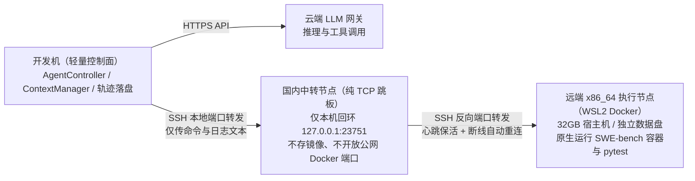

# Coding Agent Harness 项目进展报告

> 更新日期：2026-11-28
>
> 相关文档：[学习手册](coding-agent-study-guide.md) · [Week 1 计划](week1-plan.md) · [Week 1 开发日志](devlog-week1.md) · [技术笔记](../learn.md) · [验证与踩坑](../result.md)

---

## 一、总体进度一览

| 阶段 | 状态 | 核心里程碑 |
| :--- | :---: | :--- |
| **V0.0 基础框架** | ✅ 已完成 | EventStream、Local/Docker SandboxRuntime、正交 ACI 工具、ContextManager、AgentController、Eval 脚手架与全套单测 |
| **Week 1 评测底座与冒烟** | ✅ 已完成 | 锁死 30 题分层 Verified 子集与 5 题冒烟集；Empty 0/5 & Gold 5/5 双校验；DeepSeek 真实冒烟 **2/5（40%）**、缓存命中 **67.8%**、总计 **$0.052** |
| **执行面异构解耦与提速** | ✅ 已完成 | 将 70+ GB 容器镜像与 `x86_64` 算力迁移至远端 Windows WSL2（32 GB 内存 + 独立数据盘），通过国内云主机反向 SSH 隧道解耦控制面与执行面；4 并发 Gold 验收提速 **2.71x**（`210.9s → 77.7s`） |
| **Week 2 V0.1 Baseline** | 36 步基线已出分 | 30 题 Gold 对照 **26/30（86.7%）**，首轮 20 步基线 **10/30（33.3%）**。 |
| **V0.2–V0.4 消融** | 四组评测已完成 | RepoMap 通过 12/30，护栏通过 16/30。 |

---

## 二、控制面与执行面解耦架构（阶段性工程突破）

### 1. 解决的核心痛点
- Apple Silicon 开发机本地缓存 30 个 SWE-bench `linux/amd64` 镜像占用约 **73.6 GB** 磁盘，且通过 Rosetta 2 转译执行科学计算测试耗时高、并发受限。
- 将重型镜像存储与容器算力剥离至独立的原生 `x86_64` 宿主机（Windows + WSL2 Docker Desktop），开发机仅运行轻量控制面。

### 2. 架构拓扑



### 3. 安全与工程设计要点
- **零公网暴露**：执行节点的 Docker API 仅监听本机回环 `127.0.0.1:2375`；中转节点反向端口仅绑定 `127.0.0.1:23751`，不开放任何额外安全组端口。
- **双端鉴权与保活**：全链路仅使用独立 Ed25519 公钥免密认证；中转节点开启 `ClientAliveInterval 15` / `ClientAliveCountMax 3` 防止僵尸会话占用反向端口；开发机通过 macOS `launchd` LaunchAgent 与远端后台保活脚本实现断线 5 秒自动恢复。
- **代理环境兼容**：[run_swebench_eval.py](../scripts/run_swebench_eval.py) 增加本地回环 `NO_PROXY=127.0.0.1,localhost` 保护与 `ssh://` Context 兼容，避免系统代理拦截本地转发端口。

---

## 三、实测性能与并发基准对比

### 1. 隧道传输链路对比
| 隧道路径 | 典型延迟 | 稳定性与备注 |
| :--- | :---: | :--- |
| P2P / 海外中继路径 | `350 ~ 469 ms`（受上游 UDP 3478 封锁与路由影响） | 偶尔抖动、冷启动易超时 |
| 国内云主机 SSH 反向隧道 | **`108 ms`**（完整 Docker HTTP `/_ping` 往返，RTT ~35ms） | 纯 TCP 22 直连，稳定且 0 VPN 流量 |

### 2. `smoke_5` 官方 Gold Patch 评测提速对比

| 运行配置 | 通过率 | 总耗时 | 相对提速 | 单题耗时观察 |
| :--- | :---: | :---: | :---: | :--- |
| 开发机本地（ARM64 Rosetta，`--workers 1`） | 5/5 (100%) | `210.9s` | `1.00x` | 含首次镜像拉取等待，其余单题 23~31s |
| 远端 `x86_64` + 反向隧道（`--workers 1`） | 5/5 (100%) | `188.6s` | `1.12x` | `matplotlib` 79.7s，其余 4 题 24~29s |
| 远端 `x86_64` + 反向隧道（`--workers 4`） | **5/5 (100%)** | **`77.7s`** | **`2.71x`**（较远端单线程 **`2.43x`**） | `matplotlib` 77.6s，其余 4 题被完全并行掩盖，无明显资源争抢 |

- 30/30 个官方 `linux/amd64` Instance 镜像已全部在远端 `x86_64` 节点数据盘拉取就绪。

---

## 四、Week 2 冻结 30 题结果

| 实验 | 通过数 | 报告 |
| :--- | ---: | :--- |
| Gold Patch，禁用 pip 构建隔离 | 26/30（86.7%） | [官方评分](../runs/week2/gold-30-offline-pip/summary.json) |
| 首轮 V0.1，20 步 | 10/30（33.3%） | [官方评分](../runs/fix-audit/run.9xz8O8/baseline-score/summary.json) |
| 首轮 V0.1，按原审计排除 3 道有外网故障证据的题 | 10/27（37.0%） | [原噪声审计](../runs/fix-audit/run.9xz8O8/controls-audit.json) · [子集评分](../runs/fix-audit/run.9xz8O8/baseline-noise-adjusted.json) |

`gold-30-offline-pip` 使用 Docker 默认网络；4 道未通过的 Requests 题日志记录了证书错误或连接超时。消融主指标统一使用全部 30 题，按原噪声审计另报 27 题子集。 [审计口径复核](../fix.md#fix-012)

### 36 步基线与消融配置

| 组 | 批跑选项 |
| :--- | :--- |
| `baseline-36steps` | 基线默认选项 |
| `repomap` | `--with-repomap` |
| `guardrails` | `--with-loop-recovery --with-verification` |
| `compaction` | `--with-compaction` |

各组使用 `data/swebench_verified_30.jsonl`、`deepseek-flash`、`--max-steps 36 --thinking disabled`。原基线和各消融组使用 `--workers 3`，基线仅用 `--resume --workers 1` 补跑 `django__django-13401`。官方评测使用 `--mode predictions --workers 4 --timeout 300 --docker-timeout 30` 与同一份 `--noise-audit`。 [基线与消融验收](../fix.md#fix-013)

Week 3 继续使用同一模型网关，统一比较输入、缓存和输出 Token 总数及缓存命中率。当前网关的实际费率未经核实，本地三项费率为 0，日志中的 `$0.00` 无法反映实际费用，`--max-cost` 也不会触发。批跑用 `--max-steps 36` 控制每题步数。 [度量口径](../fix.md#fix-011)

补跑的 `django__django-13401` 在第 24 步正常结束，导出 3,260 字符补丁并通过官方逐题评分。补跑时手动终止了已断开连接的两个测试进程组。基线有 16/30 题主动结束、28/30 题导出非空补丁、21/30 题覆盖全部金标准文件。原基线保留了另外 29 题在更新测试工具说明之前的轨迹。 [Django 逐题评分](../runs/week2/baseline-36steps-score/instances/django__django-13401.json) · [批跑结果](../runs/week2/baseline-36steps/results.jsonl)

36 步基线官方 Pass@1 为 **17/30（56.7%）**，按原网络噪声审计为 **17/27（63.0%）**。RepoMap 为 **12/30（40.0%）**，Guardrails 为 **16/30（53.3%）**，Compaction 为 **15/30（50.0%）**。Compaction 组缓存命中率为 **95.9%**，但 30 条轨迹均未记录压缩事件。 [消融对比](../runs/week2/ablation-36steps.md) · [逐题归因](../runs/week2/baseline-36steps-attribution.md)

以下命令记录 Week 2 的运行条件。复跑 Guardrails v1 时使用代码快照 `f388d70`，因为当前的 `--with-verification` 已升级为 v2。

```bash
set -a
source .env
set +a
dataset=data/swebench_verified_30.jsonl
noise_audit=runs/fix-audit/run.9xz8O8/controls-audit.json

python scripts/run_agent_batch.py --dataset "$dataset" --max-steps 36 \
  --thinking disabled --workers 1 --resume --output-dir runs/week2/baseline-36steps

score() {
  python scripts/run_swebench_eval.py --dataset "$dataset" --mode predictions \
    --predictions "runs/week2/$1/predictions.jsonl" --workers 4 --timeout 300 \
    --docker-timeout 30 --noise-audit "$noise_audit" --output-dir "runs/week2/$1-score"
}
score baseline-36steps

python scripts/run_agent_batch.py --dataset "$dataset" --max-steps 36 \
  --thinking disabled --workers 3 --with-repomap --output-dir runs/week2/repomap
score repomap
python scripts/run_agent_batch.py --dataset "$dataset" --max-steps 36 \
  --thinking disabled --workers 3 --with-loop-recovery --with-verification \
  --output-dir runs/week2/guardrails
score guardrails
python scripts/run_agent_batch.py --dataset "$dataset" --max-steps 36 \
  --thinking disabled --workers 3 --with-compaction --output-dir runs/week2/compaction
score compaction

python scripts/compare_harness_runs.py --dataset "$dataset" \
  --baseline runs/week2/baseline-36steps runs/week2/baseline-36steps-score/summary.json \
  --variant runs/week2/repomap runs/week2/repomap-score/summary.json \
  --variant runs/week2/guardrails runs/week2/guardrails-score/summary.json \
  --variant runs/week2/compaction runs/week2/compaction-score/summary.json \
  --output runs/week2/ablation-36steps.json
```

### 评测链路更新

- 批跑和官方评测逐题保存结果，支持指定并发和续跑。Docker CLI 通过本地隧道连接远端执行节点。
- Docker 命令的宿主机超时保留沙箱。补丁导出遇到超时会再尝试一次，退出沙箱时才清理容器。已在远端容器用强制 CLI 超时验证补丁仍可导出。 [FIX-015](../fix.md#fix-015)

### Week 3 网络噪声审计

使用同一冻结题集的 30 题 Gold、最新 30 题 Empty，以及五道 Requests 题的隔离 Gold 和 Empty 对照。默认对照有 **26/30** 题符合预期，三组新跑的对照均无评测超时或环境错误。审计从 Django 原始日志补齐了 SWE-bench 未记录的子测试失败。 [审计记录](../runs/week3/day1/controls-audit.json)

去噪子集排除 Requests 的 `1724`、`1766`、`2317`、`2931`。其中 `2931` 在默认网络的 Gold 评分中通过了目标用例，两个 P2P 超时测试遇到私有地址路由差异。隔离网络的 Gold 评分通过。Week 3 各组统一传入 `--noise-audit runs/week3/day1/controls-audit.json`，同时报告原始 30 题及去噪 26 题 Pass@1。 [默认网络逐题评分](../runs/week2/gold-30-offline-pip/instances/psf__requests-2931.json) · [隔离网络逐题评分](../runs/week3/day1/requests-none-gold/instances/psf__requests-2931.json)

用新版审计重新汇总 Week 2 的既有评分，基线为 **16/26（61.5%）**，RepoMap 为 **11/26（42.3%）**，Guardrails 为 **15/26（57.7%）**，Compaction 为 **14/26（53.8%）**。原始 30 题评分及旧 27 题去噪报告保留。 [四组原始评分](../runs/week2/ablation-36steps.md)

### Week 3 Day 2 · Guardrails v2

`run_command` 与 `run_test` 共用验证证据。门禁只接受当前补丁的相关测试通过记录。基线复现可选，提交仍要求业务源码改动，并提示如何只清理命中的官方测试改动或新增临时文件。后 5 步根据实际工作树判断是否提示立即落盘最小修复。

使用相同 5 题、`deepseek-flash`、36 步上限和 `--thinking disabled`，对照 Week 2 Guardrails v1 的同题子集。提交尝试包含显式 `finish` 和由最终文字回复触发的检查。

| 指标 | Guardrails v1 | Guardrails v2 |
| --- | ---: | ---: |
| 官方 Pass@1 | 3/5 | 2/5 |
| 完成提交 | 1/5 | 3/5 |
| 提交拒绝 | 6/7（85.7%） | 5/8（62.5%） |
| 因缺少基线失败被拒 | 3 | 0 |
| 平均步数 | 31.6 | 28.2 |
| 空补丁 | 0 | 0 |

v2 的官方通过数少了一题。Matplotlib 从通过变为未通过，pytest 通过门禁后仍未通过官方评分。30 题效果及失败归因留待 Day 4 验证。 [v2 批跑结果](../runs/week3/guardrails-v2-smoke/results.jsonl) · [v2 官方评分](../runs/week3/guardrails-v2-smoke-score/summary.json) · [v1 官方评分](../runs/week2/guardrails-score/summary.json)

后续复核发现，上述 Guardrails v1 和 v2 冒烟曾使用评测补丁的测试文件路径作为提示。新版批跑入口仅投影问题描述、仓库和沙箱身份字段。门禁按工作树识别既有测试和新增临时文件，测试通过记录只绑定业务源码差异。历史护栏成绩保留为诊断记录，零泄露口径正在重新评测。 [FIX-017](../fix.md#fix-017) · [FIX-018](../fix.md#fix-018)

### FIX-019 压缩阈值校准

回放 Week 2 Compaction 组的 774 轮历史消息。未压缩时，单轮估算中位数约 9.8K，峰值约 24.0K。默认阈值调整到 18K，回放中有 12/30 条轨迹触发压缩，其中 11 条不少于 30 步。估算输入总量从 7.97M 降到 6.40M，减少约 20%。 [校准数据](../runs/week3/fix-019-calibration.json)

实测 30 题零泄露护栏与 18K 压缩结果如下：
- `guardrails-worktree-30`（零泄露工作树门禁）：**15/30（50.0%）**，去噪 26 题 **14/26（53.8%）**，空补丁 4，循环 3。
- `compaction-18k-30`（18K 阈值触发 12 次压缩）：**10/30（33.3%）**，去噪 26 题 **10/26（38.5%）**，缓存命中率 94.6%，但规则摘要清除了已读代码导致失忆与循环（5 题 `loop_detected`、6 题空补丁）。 [对比报告](../runs/week3/fix-017-019-comparison.json)

### Week 3 通过率突破 · 根因级 Harness 优化（`boost-30`）

针对前 6 轮 30 题全量实验通过率卡在 56.7%（且各单一外挂特性均掉分）的根因排查，定位并一次性落地 6 项底层修复（零评测泄露，仍使用同一模型 `deepseek-flash`）：
1. **消除上下文失忆**：`keep_recent_observations` `5 → 16`、`mask_threshold_chars` `600 → 3000`，且永不遮蔽 `edit_file` / `git_status_diff`（此前 `django-13112` 因失忆重复 `view_file` 49 次、精确重复 23 次）。
2. **扩大代码阅读窗口**：`MAX_VIEW_LINES` `150 → 300`（默认 250 行）、`MAX_SEARCH_MATCHES` `30 → 40`，并无条件开启 `edit_file` 最近似行号反馈。
3. **升级系统工程纪律提示词**：强调修根因不修表面、并行批读、用独立脚本/既有测试验证而不误改仓库测试文件。
4. **启用深度思考安全回放与容错**：支持 `--thinking enabled`（强制 `max_tokens ≥ 16384`，保留 `reasoning_content` 并剥离非标网关字段）；修复 `finish_reason="length"` 无工具调用被误判为 `finished` 的 Bug；新增畸形 tool-call JSON 容错。
5. **默认开启 `pipefail` + 软循环恢复**：配合 40 步上限（`--max-steps 40 --thinking enabled --pipefail --with-loop-recovery`）。

| 指标 | Week 2 Baseline (36步) | **Week 3 Boost (`boost-30`)** | 变化 |
| :--- | :---: | :---: | :---: |
| **30 题全量 Pass@1** | 17/30 (56.7%) | **21/30 (70.0%)** | **+13.3%**（+7 / -3） |
| **26 题去噪 Pass@1** | 16/26 (61.5%) | **20/26 (76.9%)** | **+15.4%** |
| 非空补丁 | 28/30 | **30/30 (100%)** | 空补丁归零 |
| `loop_detected` | 1 | **0** | 循环熔断归零 |
| 金标准文件定位 | 26/30 (86.7%) | **29/30 (96.7%)** | +3 题 |
| Prompt Cache 命中率 | 66.8% | **84.0%** | **+17.2%** |
| 总 Prompt Tokens | 5.61M | 22.46M（未命中 3.59M） | 换取大幅提分 |

- **分仓库通过率**：`scikit-learn` **5/5 (100%)**、`pytest` **4/5 (80%)**、`sympy` **4/5 (80%)**、`django` **3/5 (60%)**、`matplotlib` **3/5 (60%)**、`psf/requests` **2/5**（可解 2 题全过）。
- **攻克 4 道此前 6 轮全败（0/6）难题**：`django__django-13112`、`django__django-13794`、`psf__requests-6028`、`sympy__sympy-13551`，另新增通过 `pytest-7205`、`pytest-7324`、`scikit-learn-14087`。
- **真实人民币成本核算**（网关费率：未缓存输入 ¥2.0 / 1M、缓存输入 ¥0.2 / 1M、输出 ¥2.0 / 1M）：

| 实验组 | Pass@1（30题） | 总输入 / 缓存（命中率） | 输出 Token | 30 题总成本 | 单题成本 | 每通过 1 题成本 |
| :--- | :---: | :---: | :---: | :---: | :---: | :---: |
| Week 2 Baseline (36 步) | 17/30 (56.7%) | 5.61M / 3.75M (66.8%) | 131.6K | **¥4.74** | ¥0.158 | ¥0.279 |
| Week 2 Compaction 60K | 15/30 (50.0%) | 8.66M / 8.31M (95.9%) | 134.8K | **¥2.63** | ¥0.088 | ¥0.176 |
| Week 3 Guardrails v2 零泄露 | 15/30 (50.0%) | 5.95M / 4.27M (71.8%) | 137.3K | **¥4.48** | ¥0.149 | ¥0.299 |
| Week 3 Compaction 18K | 10/30 (33.3%) | 7.45M / 7.05M (94.6%) | 141.4K | **¥2.49** | ¥0.083 | ¥0.249 |
| **Week 3 Boost (40 步)** | **21/30 (70.0%)** | **22.46M / 18.86M (84.0%)** | **737.7K** | **¥12.43** | **¥0.414** | **¥0.592** |

  - 成本拆解显示：`boost-30` 中 18.86M 缓存输入仅占 **¥3.77**（单价为未缓存的 1/10），主要开销在 3.59M 未缓存输入（¥7.18）与 737.7K 输出（¥1.48）；若进一步稳定历史前缀将缓存命中率从 84% 提至 95%，总成本有望从 ¥12.43 降至 ~¥6.5。
- 证据：[30 题官方评分](../runs/week3/boost-30-score/summary.json) · [基线对比报告](../runs/week3/boost-30-comparison.json) · [6 题难题先导验证（3/6）](../runs/week3/boost-hard6-score/summary.json)

### Week 3 Day 3 · 单因子拆因消融与全前缀高缓存突破（22/30，去噪 80.8%）

为精确分离「Harness 工程改动」与「Thinking 深度推理」的独立贡献，并验证零滑动改写前缀对 Prompt Caching 的收益，在同一锁定 30 题集、同一模型 `deepseek-flash` 与统一 CNY 费率（未缓存 ¥2.0 / 缓存 ¥0.2 / 输出 ¥2.0 每百万 Token）下完成四组对照评测：

| 实验组 | 30 题 Pass@1 | 26 题去噪 Pass@1 | 输入 / 缓存 / 输出 Token | 缓存命中率 | 30 题总成本 | 单题 / 每通过 1 题 | 平均步数 | 空补丁 / 循环 |
| :--- | ---: | ---: | ---: | ---: | ---: | ---: | ---: | ---: |
| `baseline-36steps`（36 步, thinking=off） | 17/30 (56.7%) | 16/26 (61.5%) | 5.61M / 3.75M / 131.6K | 66.79% | ¥4.74 | ¥0.158 / ¥0.279 | 28.3 | 2 / 1 |
| `ablation-harness-nothink`（40 步, 新 Harness, thinking=off） | 13/30 (43.3%) | 12/26 (46.2%) | 14.70M / 11.86M / 173.0K | 80.69% | ¥8.40 | ¥0.280 / ¥0.646 | 33.4 | 4 / 4 |
| `boost-30`（40 步, 新 Harness + mask16, thinking=on） | 21/30 (70.0%) | 20/26 (76.9%) | 22.46M / 18.86M / 737.7K | 84.00% | ¥12.43 | ¥0.414 / ¥0.592 | 30.6 | 0 / 0 |
| **`ablation-fullprefix`（40 步, 零遮蔽, thinking=on）** | **22/30 (73.3%)** | **21/26 (80.8%)** | **27.25M / 26.61M / 714.7K** | **97.68%** | **¥8.02** | **¥0.267 / ¥0.364** | **29.9** | **0 / 0** |

核心实证结论（完整复盘与新增待修项 `FIX-020`~`022` 见 [Week 3 修复台账](week3-fix.md)）：
1. **全前缀不可变（`HARNESS_KEEP_RECENT_OBSERVATIONS=0`）实现质量、缓存、成本三赢**：未缓存输入从 `3.59M` 降至 `0.63M`，缓存命中率跃升至 **97.68%**，30 题总成本从 `¥12.43` 降至 **¥8.02（-35.5%，每通过 1 题 ¥0.364）**，同时官方 Pass@1 创下 **22/30（73.3%）**、去噪 **21/26（80.8%）** 新高，且 0 空补丁、0 循环、0 上下文超限、5 道干净未过题全部 0 回归。
2. **拆因证实「推理深度 × Harness 复杂度」强交互**：在关闭 Thinking 时，新 Harness 放大上下文 2.6× 反而引发 4 例 E5 回归（`13/30`，¥8.40）；同 Harness 下开启 Thinking 贡献 **`+8 / -0`（零退化）** 的纯增量，且配齐全前缀缓存后总成本（¥8.02）反低于关 Thinking 组（¥8.40）。
3. **验证 Best-of-K 上限**：仅 `boost-30 ∪ ablation-fullprefix` 双采样 Oracle 并集即达 **23/30（76.7%）**、去噪 **22/26（84.6%）**；双轮均未攻克的干净难题收敛至 4 题（`django-13212`、`matplotlib-26466`、`pytest-10356`、`sympy-14248`），为 Day 4~6 按需 `get_repo_map`、只读 Explorer 与 Best-of-3 Verifier 提供清晰靶点。
