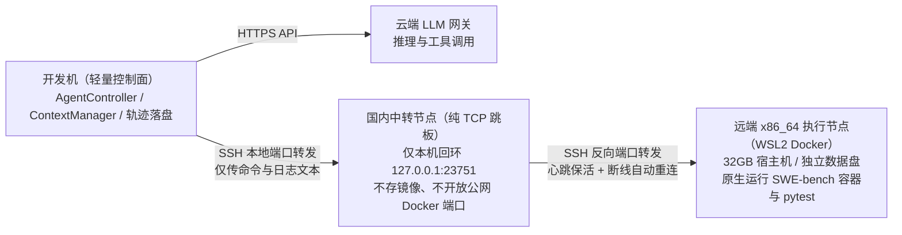

# Coding Agent Harness 项目进展报告

> 更新日期：2026-11-28
>
> 相关文档：[学习手册](coding-agent-study-guide.md) · [Week 1 计划](week1-plan.md) · [Week 1 开发日志](devlog-week1.md) · [技术笔记](../learn.md) · [验证与踩坑](../result.md)

---

## 一、总体进度一览

| 阶段 | 状态 | 核心里程碑 |
| :--- | :---: | :--- |
| **V0.0 基础框架** | ✅ 已完成 | EventStream、Local/Docker SandboxRuntime、正交 ACI 工具、ContextManager、AgentController、Eval 脚手架与全套单测 |
| **Week 1 评测底座与冒烟** | ✅ 已完成 | 锁死 30 题分层 Verified 子集与 5 题冒烟集；Empty 0/5 & Gold 5/5 双校验；DeepSeek 真实冒烟 **2/5（40%）**、缓存命中 **67.8%**、总计 **$0.052** |
| **执行面异构解耦与提速** | ✅ 已完成 | 将 70+ GB 容器镜像与 `x86_64` 算力迁移至远端 Windows WSL2（32 GB 内存 + 独立数据盘），通过国内云主机反向 SSH 隧道解耦控制面与执行面；4 并发 Gold 验收提速 **2.71x**（`210.9s → 77.7s`） |
| **Week 2 V0.1 Baseline** | 36 步基线已出分 | 30 题 Gold 对照 **26/30（86.7%）**，首轮 20 步基线 **10/30（33.3%）**。 |
| **V0.2–V0.4 消融** | 四组评测已完成 | RepoMap 通过 12/30，护栏通过 16/30。 |

---

## 二、控制面与执行面解耦架构（阶段性工程突破）

### 1. 解决的核心痛点
- Apple Silicon 开发机本地缓存 30 个 SWE-bench `linux/amd64` 镜像占用约 **73.6 GB** 磁盘，且通过 Rosetta 2 转译执行科学计算测试耗时高、并发受限。
- 将重型镜像存储与容器算力剥离至独立的原生 `x86_64` 宿主机（Windows + WSL2 Docker Desktop），开发机仅运行轻量控制面。

### 2. 架构拓扑



### 3. 安全与工程设计要点
- **零公网暴露**：执行节点的 Docker API 仅监听本机回环 `127.0.0.1:2375`；中转节点反向端口仅绑定 `127.0.0.1:23751`，不开放任何额外安全组端口。
- **双端鉴权与保活**：全链路仅使用独立 Ed25519 公钥免密认证；中转节点开启 `ClientAliveInterval 15` / `ClientAliveCountMax 3` 防止僵尸会话占用反向端口；开发机通过 macOS `launchd` LaunchAgent 与远端后台保活脚本实现断线 5 秒自动恢复。
- **代理环境兼容**：[run_swebench_eval.py](../scripts/run_swebench_eval.py) 增加本地回环 `NO_PROXY=127.0.0.1,localhost` 保护与 `ssh://` Context 兼容，避免系统代理拦截本地转发端口。

---

## 三、实测性能与并发基准对比

### 1. 隧道传输链路对比
| 隧道路径 | 典型延迟 | 稳定性与备注 |
| :--- | :---: | :--- |
| P2P / 海外中继路径 | `350 ~ 469 ms`（受上游 UDP 3478 封锁与路由影响） | 偶尔抖动、冷启动易超时 |
| 国内云主机 SSH 反向隧道 | **`108 ms`**（完整 Docker HTTP `/_ping` 往返，RTT ~35ms） | 纯 TCP 22 直连，稳定且 0 VPN 流量 |

### 2. `smoke_5` 官方 Gold Patch 评测提速对比

| 运行配置 | 通过率 | 总耗时 | 相对提速 | 单题耗时观察 |
| :--- | :---: | :---: | :---: | :--- |
| 开发机本地（ARM64 Rosetta，`--workers 1`） | 5/5 (100%) | `210.9s` | `1.00x` | 含首次镜像拉取等待，其余单题 23~31s |
| 远端 `x86_64` + 反向隧道（`--workers 1`） | 5/5 (100%) | `188.6s` | `1.12x` | `matplotlib` 79.7s，其余 4 题 24~29s |
| 远端 `x86_64` + 反向隧道（`--workers 4`） | **5/5 (100%)** | **`77.7s`** | **`2.71x`**（较远端单线程 **`2.43x`**） | `matplotlib` 77.6s，其余 4 题被完全并行掩盖，无明显资源争抢 |

- 30/30 个官方 `linux/amd64` Instance 镜像已全部在远端 `x86_64` 节点数据盘拉取就绪。

---

## 四、Week 2 冻结 30 题结果

| 实验 | 通过数 | 报告 |
| :--- | ---: | :--- |
| Gold Patch，禁用 pip 构建隔离 | 26/30（86.7%） | [官方评分](../runs/week2/gold-30-offline-pip/summary.json) |
| 首轮 V0.1，20 步 | 10/30（33.3%） | [官方评分](../runs/fix-audit/run.9xz8O8/baseline-score/summary.json) |
| 首轮 V0.1，按原审计排除 3 道有外网故障证据的题 | 10/27（37.0%） | [原噪声审计](../runs/fix-audit/run.9xz8O8/controls-audit.json) · [子集评分](../runs/fix-audit/run.9xz8O8/baseline-noise-adjusted.json) |

`gold-30-offline-pip` 使用 Docker 默认网络；4 道未通过的 Requests 题日志记录了证书错误或连接超时。消融主指标统一使用全部 30 题，按原噪声审计另报 27 题子集。 [审计口径复核](../fix.md#fix-012)

### 36 步基线与消融配置

| 组 | 批跑选项 |
| :--- | :--- |
| `baseline-36steps` | 基线默认选项 |
| `repomap` | `--with-repomap` |
| `guardrails` | `--with-loop-recovery --with-verification` |
| `compaction` | `--with-compaction` |

各组使用 `data/swebench_verified_30.jsonl`、`deepseek-flash`、`--max-steps 36 --thinking disabled`。原基线和各消融组使用 `--workers 3`，基线仅用 `--resume --workers 1` 补跑 `django__django-13401`。官方评测使用 `--mode predictions --workers 4 --timeout 300 --docker-timeout 30` 与同一份 `--noise-audit`。 [基线与消融验收](../fix.md#fix-013)

Week 3 继续使用同一模型网关，统一比较输入、缓存和输出 Token 总数及缓存命中率。当前网关的实际费率未经核实，本地三项费率为 0，日志中的 `$0.00` 无法反映实际费用，`--max-cost` 也不会触发。批跑用 `--max-steps 36` 控制每题步数。 [度量口径](../fix.md#fix-011)

补跑的 `django__django-13401` 在第 24 步正常结束，导出 3,260 字符补丁并通过官方逐题评分。补跑时手动终止了已断开连接的两个测试进程组。基线有 16/30 题主动结束、28/30 题导出非空补丁、21/30 题覆盖全部金标准文件。原基线保留了另外 29 题在更新测试工具说明之前的轨迹。 [Django 逐题评分](../runs/week2/baseline-36steps-score/instances/django__django-13401.json) · [批跑结果](../runs/week2/baseline-36steps/results.jsonl)

36 步基线官方 Pass@1 为 **17/30（56.7%）**，按原网络噪声审计为 **17/27（63.0%）**。RepoMap 为 **12/30（40.0%）**，Guardrails 为 **16/30（53.3%）**，Compaction 为 **15/30（50.0%）**。Compaction 组缓存命中率为 **95.9%**，但 30 条轨迹均未记录压缩事件。 [消融对比](../runs/week2/ablation-36steps.md) · [逐题归因](../runs/week2/baseline-36steps-attribution.md)

从仓库根目录运行，先加载和基线指纹一致的模型及沙箱配置。

```bash
set -a
source .env
set +a
dataset=data/swebench_verified_30.jsonl
noise_audit=runs/fix-audit/run.9xz8O8/controls-audit.json

python scripts/run_agent_batch.py --dataset "$dataset" --max-steps 36 \
  --thinking disabled --workers 1 --resume --output-dir runs/week2/baseline-36steps

score() {
  python scripts/run_swebench_eval.py --dataset "$dataset" --mode predictions \
    --predictions "runs/week2/$1/predictions.jsonl" --workers 4 --timeout 300 \
    --docker-timeout 30 --noise-audit "$noise_audit" --output-dir "runs/week2/$1-score"
}
score baseline-36steps

python scripts/run_agent_batch.py --dataset "$dataset" --max-steps 36 \
  --thinking disabled --workers 3 --with-repomap --output-dir runs/week2/repomap
score repomap
python scripts/run_agent_batch.py --dataset "$dataset" --max-steps 36 \
  --thinking disabled --workers 3 --with-loop-recovery --with-verification \
  --output-dir runs/week2/guardrails
score guardrails
python scripts/run_agent_batch.py --dataset "$dataset" --max-steps 36 \
  --thinking disabled --workers 3 --with-compaction --output-dir runs/week2/compaction
score compaction

python scripts/compare_harness_runs.py --dataset "$dataset" \
  --baseline runs/week2/baseline-36steps runs/week2/baseline-36steps-score/summary.json \
  --variant runs/week2/repomap runs/week2/repomap-score/summary.json \
  --variant runs/week2/guardrails runs/week2/guardrails-score/summary.json \
  --variant runs/week2/compaction runs/week2/compaction-score/summary.json \
  --output runs/week2/ablation-36steps.json
```

### 评测链路更新

- 批跑和官方评测逐题保存结果，支持指定并发和续跑。Docker CLI 通过本地隧道连接远端执行节点。
- Docker 命令的宿主机超时保留沙箱。补丁导出遇到超时会再尝试一次，退出沙箱时才清理容器。已在远端容器用强制 CLI 超时验证补丁仍可导出。 [FIX-015](../fix.md#fix-015)

### Week 3 网络噪声审计

使用同一冻结题集的 30 题 Gold、最新 30 题 Empty，以及五道 Requests 题的隔离 Gold 和 Empty 对照。默认对照有 **26/30** 题符合预期，三组新跑的对照均无评测超时或环境错误。审计从 Django 原始日志补齐了 SWE-bench 未记录的子测试失败。 [审计记录](../runs/week3/day1/controls-audit.json)

去噪子集排除 Requests 的 `1724`、`1766`、`2317`、`2931`。其中 `2931` 在默认网络的 Gold 评分中通过了目标用例，两个 P2P 超时测试遇到私有地址路由差异。隔离网络的 Gold 评分通过。Week 3 各组统一传入 `--noise-audit runs/week3/day1/controls-audit.json`，同时报告原始 30 题及去噪 26 题 Pass@1。 [默认网络逐题评分](../runs/week2/gold-30-offline-pip/instances/psf__requests-2931.json) · [隔离网络逐题评分](../runs/week3/day1/requests-none-gold/instances/psf__requests-2931.json)

用新版审计重新汇总 Week 2 的既有评分，基线为 **16/26（61.5%）**，RepoMap 为 **11/26（42.3%）**，Guardrails 为 **15/26（57.7%）**，Compaction 为 **14/26（53.8%）**。原始 30 题评分及旧 27 题去噪报告保留。 [四组原始评分](../runs/week2/ablation-36steps.md)
