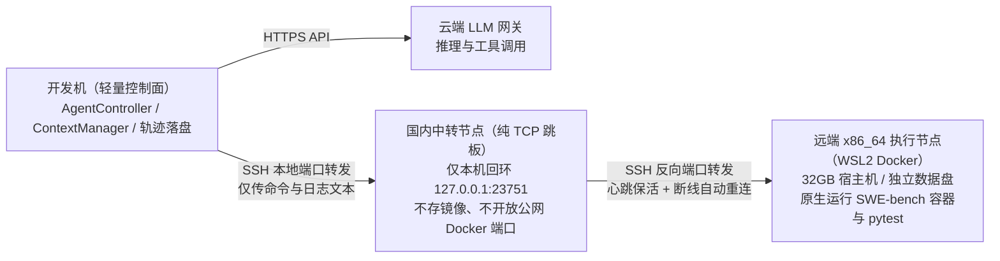

# Coding Agent Harness 项目进展报告

> 更新日期：2026-11-26  
> 相关文档：[学习手册](coding-agent-study-guide.md) · [Week 1 计划](week1-plan.md) · [Week 1 开发日志](devlog-week1.md) · [技术笔记](../learn.md) · [验证与踩坑](../result.md)

---

## 一、总体进度一览

| 阶段 | 状态 | 核心里程碑 |
| :--- | :---: | :--- |
| **V0.0 基础框架** | ✅ 已完成 | EventStream、Local/Docker SandboxRuntime、正交 ACI 工具、ContextManager、AgentController、Eval 脚手架与全套单测 |
| **Week 1 评测底座与冒烟** | ✅ 已完成 | 锁死 30 题分层 Verified 子集与 5 题冒烟集；Empty 0/5 & Gold 5/5 双校验；DeepSeek 真实冒烟 **2/5（40%）**、缓存命中 **67.8%**、总计 **$0.052** |
| **执行面异构解耦与提速** | ✅ 已完成 | 将 70+ GB 容器镜像与 `x86_64` 算力迁移至远端 Windows WSL2（32 GB 内存 + 独立数据盘），通过国内云主机反向 SSH 隧道解耦控制面与执行面；4 并发 Gold 验收提速 **2.71x**（`210.9s → 77.7s`） |
| **Week 2 V0.1 Baseline** | 🔜 下一步 | 30 题全量 Gold 离线校验 → 修补 Week 1 Review 隐患 → 批跑脚本并发化 → 跑出 30 题 V0.1 Baseline 与 `E1~E6` 归因 |

---

## 二、控制面与执行面解耦架构（阶段性工程突破）

### 1. 解决的核心痛点
- Apple Silicon 开发机本地缓存 30 个 SWE-bench `linux/amd64` 镜像占用约 **73.6 GB** 磁盘，且通过 Rosetta 2 转译执行科学计算测试耗时高、并发受限。
- 将重型镜像存储与容器算力剥离至独立的原生 `x86_64` 宿主机（Windows + WSL2 Docker Desktop），开发机仅运行轻量控制面。

### 2. 架构拓扑

### 3. 安全与工程设计要点
- **零公网暴露**：执行节点的 Docker API 仅监听本机回环 `127.0.0.1:2375`；中转节点反向端口仅绑定 `127.0.0.1:23751`，不开放任何额外安全组端口。
- **双端鉴权与保活**：全链路仅使用独立 Ed25519 公钥免密认证；中转节点开启 `ClientAliveInterval 15` / `ClientAliveCountMax 3` 防止僵尸会话占用反向端口；开发机通过 macOS `launchd` LaunchAgent 与远端后台保活脚本实现断线 5 秒自动恢复。
- **代理环境兼容**：[run_swebench_eval.py](../scripts/run_swebench_eval.py) 增加本地回环 `NO_PROXY=127.0.0.1,localhost` 保护与 `ssh://` Context 兼容，避免系统代理拦截本地转发端口。

---

## 三、实测性能与并发基准对比

### 1. 隧道传输链路对比
| 隧道路径 | 典型延迟 | 稳定性与备注 |
| :--- | :---: | :--- |
| P2P / 海外中继路径 | `350 ~ 469 ms`（受上游 UDP 3478 封锁与路由影响） | 偶尔抖动、冷启动易超时 |
| 国内云主机 SSH 反向隧道 | **`108 ms`**（完整 Docker HTTP `/_ping` 往返，RTT ~35ms） | 纯 TCP 22 直连，稳定且 0 VPN 流量 |

### 2. `smoke_5` 官方 Gold Patch 评测提速对比

| 运行配置 | 通过率 | 总耗时 | 相对提速 | 单题耗时观察 |
| :--- | :---: | :---: | :---: | :--- |
| 开发机本地（ARM64 Rosetta，`--workers 1`） | 5/5 (100%) | `210.9s` | `1.00x` | 含首次镜像拉取等待，其余单题 23~31s |
| 远端 `x86_64` + 反向隧道（`--workers 1`） | 5/5 (100%) | `188.6s` | `1.12x` | `matplotlib` 79.7s，其余 4 题 24~29s |
| 远端 `x86_64` + 反向隧道（`--workers 4`） | **5/5 (100%)** | **`77.7s`** | **`2.71x`**（较远端单线程 **`2.43x`**） | `matplotlib` 77.6s，其余 4 题被完全并行掩盖，无明显资源争抢 |

- 30/30 个官方 `linux/amd64` Instance 镜像已全部在远端 `x86_64` 节点数据盘拉取就绪。
- 预估在 4~6 并发下，30 题全量 SWE-bench 评测总耗时可压至 **4~5 分钟**。

---

## 四、Week 1 代码与实验 Review 待办清单（进入 Week 2 优先处理）

1. **【P0】30 题全量离线 Gold 校验**：验证冻结 30 题中所有样本（重点核查 `psf/requests` 5 题）在离线容器下均可 100% 通过 Gold Patch，确保 V0.1~V0.4 消融分母干净。
2. **【P1】修复 `pytest ... | tail` 吞退出码**：在命令执行层开启 `pipefail` 并在 `run_command` 工具描述中约束模型不要对测试命令做尾部管道截断（解决 Week 1 `pytest-7205` Bad Case）。
3. **【P1】畸形 Tool Call JSON 容错**：在 `OpenAICompatibleClient` 捕获 `json.JSONDecodeError`，转为错误 `Observation` 反馈给模型自纠正，避免单步格式错中断整题。
4. **【P2】`DockerSandboxRuntime` 边界与状态对齐**：补齐文件接口的工作区路径越界检查；将 `checkpoint`/`rollback` 与临时索引和 `_patch_base` 语义对齐。
5. **【P2】批跑脚本参数化与并发化**：为 `scripts/run_agent_batch.py` 补充 `--max-steps`、`--max-cost`、`--with-repomap` 与 `--workers`（4~6 并发），用于正式跑出 **30 题 V0.1 Baseline** 与完整 `E1~E6` 归因表。
